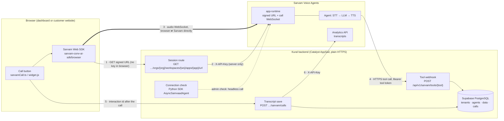

# Voice calls with Sarvam Voice Agents

Kural no longer runs its own STT → LLM → TTS voice pipeline (it remains on the `main` branch at `ad17453`).
Voice calls run on **hosted Sarvam Voice Agents (Samvaad)**: Sarvam does speech recognition, the LLM turn and
speech synthesis, and calls Kural's business tools over HTTPS. Text chat and the website text widget still use
Kural's own engine (`app/orchestration/engine.py`).

## Architecture



The only long-lived connection (the call's audio WebSocket) is between the **browser and Sarvam**. Every request
that reaches Kural is a short HTTPS request, which is all Catalyst AppSail supports.

## Why the Web SDK and not the Python SDK for live calls

| | **A. Python SDK on the backend** (`AsyncSamvaadAgent`, headless) | **B. Web SDK in the browser** (chosen) |
|---|---|---|
| Sarvam connection | Backend ⇄ Sarvam WebSocket (managed by the SDK) | Browser ⇄ Sarvam WebSocket (managed by the SDK) |
| Browser ⇄ backend | Needs a **persistent, two-way audio stream** (WebSocket or WebRTC) for the whole call: mic PCM in, agent audio out, barge-in | Short HTTPS GET for a signed URL, then nothing |
| Works on AppSail | **No**: AppSail's gateway drops WebSocket upgrades (they reach the app as plain GETs → 404) and ends requests after 30 s | **Yes**: verified that every Kural request involved is plain HTTPS |
| API key | Server | Server (the session route adds it; `apiKey: ""` in the browser) |
| Extra infrastructure | A WebSocket-capable voice service (VM, Render, Fly, Railway…) next to AppSail | None |
| Latency | Browser → backend → Sarvam (extra hop) | Browser → Sarvam |
| Barge-in, playback, mic | Must be rebuilt on both ends | Built into the SDK (`user_interrupt` clears playback) |

The Python SDK's `start()` fetches the signed URL internally and connects from wherever it runs; it has no
documented way to hand that URL to a browser. So option A always needs a browser ⇄ backend audio channel.

Kural still uses the **official Python SDK** where it fits without a new server:
- **Connection check** (`POST /api/v1/agents/{id}/sarvam/check`, button *Check connection*): a ~10 s headless
  call — `start()` → `wait_for_connect()` → `send_audio()` (silence) while waiting for the greeting →
  `stop()` in `finally`. It verifies the key, ids, committed agent version and credits without a microphone.
- **Local voice test** (`backend/scripts/sarvam_voice_call.py`): talk to the agent from this PC's mic with
  `AsyncDefaultAudioInterface`.

If you later need phone-grade features Sarvam's hosted runtime can't give (custom media handling), run option A as a
separate WebSocket-capable voice service; keep the business APIs on AppSail.

## Business behaviour

The Sarvam agent's prompt, voice and languages are configured in Sarvam. Kural supplies the business:
- **Tools** (per agent, read-only for now): `search_knowledge`, `get_business_info`, property search/details/pricing
  (real estate), doctor/department/slot lookups (healthcare). Tenant and agent come from the tool token, never from
  the request. Bookings and other writes are refused on this channel until the caller's own "yes" can be verified.
- **Business context** (optional, `SARVAM_AGENTS_SEND_CONTEXT=true`): `agent_variables` sent at call start —
  `business_name`, `business_phone`, `business_hours`, `business_services`, `persona_name`, `languages`. Public
  business facts only, never customer data. Declare these variables in the Sarvam agent before enabling.
- **Transcripts**: saved under *Calls* (channel `sarvam_voice`) after each call from Sarvam's Analytics API.

For a gentle, professional voice: in Sarvam, pick a warm speaker, keep the pace a little under 1.0, and use a prompt
like "You are {{persona_name}}, the receptionist at {{business_name}}. Be warm, calm and brief; confirm details
back; never guess — use the tools." Enable the agent's languages (e.g. English, Tamil, Hindi).

## Configuration

| Variable | Where | Purpose |
|---|---|---|
| `SARVAM_AGENTS_API_KEY` | backend only | Voice Agents key (indus.sarvam.ai → Samvaad → Settings → API key). Signs calls, fetches transcripts, runs the check. **Separate from `SARVAM_API_KEY`** (the model API key used for text chat). |
| `SARVAM_AGENTS_ORG_ID`, `SARVAM_AGENTS_WORKSPACE_ID` | backend | Defaults for every agent (Deploy with Code page). |
| `SARVAM_AGENTS_APP_ID` | backend | Default agent id; normally set per agent in the dashboard instead. |
| `SARVAM_AGENTS_SEND_CONTEXT` | backend | `true` to send business `agent_variables`. Default `false`. |
| `SARVAM_AGENTS_BASE_URL`, `SARVAM_AGENTS_ANALYTICS_URL` | backend | Override only if Sarvam changes endpoints. |

Per-agent settings (stored in `sarvam_agent_links`, tenant-scoped): org/workspace/app ids, *Accept tool calls*, and the
hashed tool token. Nothing Sarvam-specific is hard-coded.

## Setup

1. In Sarvam: create the agent, add the tools (URLs and token from Kural's *Agents → Sarvam Voice Agent* panel;
   method POST, Bearer auth, body = the tool's arguments as JSON, optional `X-Interaction-Id` header from
   *@ → Interaction ID*), **commit/publish** a version, top up credits.
2. In Kural's environment: set the variables above, restart.
3. In the dashboard: *Agents → (agent) → Sarvam Voice Agent*: app id, tick *Accept tool calls*, **Save**,
   **Create tool token** (shown once). Click **Check connection**, then **Test call**.
4. Website: the widget (`<script src=".../widget.js" data-agent="...">`) shows **Call** once the agent can take calls.

## Local run

```bash
uv run --directory backend uvicorn app.main:app --port 8000 --reload
npm --prefix frontend run dev                      # http://localhost:5173
cd backend && uv run pytest -q -p no:cacheprovider -W ignore
cd backend && uv run --with pyaudio python scripts/sarvam_voice_call.py --app-id <agent id>   # mic test
```

Tool calls from Sarvam need a public HTTPS URL, so they only reach a deployed Kural (or a tunnel).

## Catalyst AppSail assessment

| Requirement | AppSail | Result |
|---|---|---|
| Browser ⇄ backend WebSocket | Upgrades dropped (tested: `/voice/ws` handshake → 404 from the app) | Not used |
| Request time | 30 s limit | Longest Kural request: connection check ≈ 10–20 s |
| CORS preflight from other sites | Gateway answers `OPTIONS` itself, no CORS headers | Widget sends only simple requests (`text/plain`, token in body/path) |
| Outbound HTTPS/WebSocket to Sarvam | Allowed | Used by the session route, transcripts and the Python SDK check |
| Instances stop when idle; up to 5 copies | — | Calls hold no server state; the duplicate-check lock is per process (best effort) |

## Production recommendations

- Rotate any key that was ever pasted into chat or logs; keep keys only in AppSail environment variables.
- Allow-list Sarvam's tool-call IPs (`4.213.167.70`, `35.154.84.150`) if you front the tool webhook with a firewall.
- Add Redis (`REDIS_URL`) before running more than one AppSail instance (text-chat state).
- Before enabling bookings over voice, design a server-verified confirmation (e.g. a confirmation code read back
  and spoken by the caller), then allow specific write tools.
- Monitor Sarvam credits; calls fail with 402 when they run out (the UI explains it).
